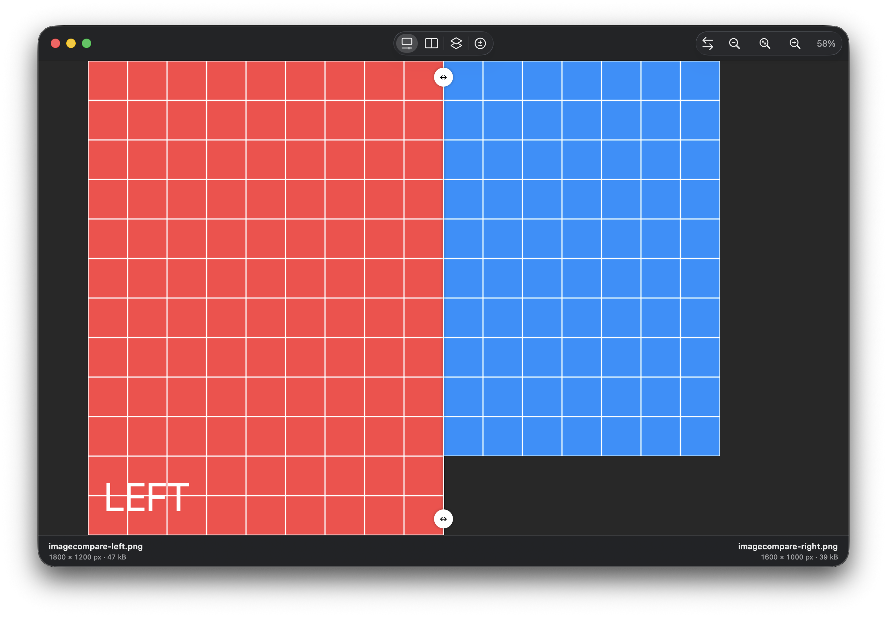

# ImageCompare

A native macOS app for comparing two images, built with SwiftUI and Core Image.



Compare images in four modes:

- **Swipe:** reveal each image with a draggable divider. Move either handle around the frame to angle the split.
- **Side by Side:** view both images with synchronized zoom and pan.
- **Onion Skin:** blend the images with adjustable opacity.
- **Difference:** highlight perceptual color differences, with a threshold and pixel statistics.

Drop two images onto the app window or Dock icon to start a comparison. Finder’s **Open With** works too. Images of different sizes share a canvas aligned at the top left.

## Requirements

macOS 26 or later and Xcode with Swift 6.2 support. No third-party dependencies.

## Build and run

Open `ImageCompare.xcodeproj` in Xcode, select the **ImageCompare** scheme, and run it. To build from the terminal:

```sh
xcodebuild -project ImageCompare.xcodeproj -scheme ImageCompare -destination 'platform=macOS' build
```

To build a Release app and package it as a DMG:

```sh
./scripts/build-dmg.sh
```

The disk image is written to `dist/ImageCompare-<version>.dmg`. The script uses ad-hoc signing by default; distribution signing is described in [the packaging documentation](Documentation/Layout.md#building-a-dmg).

## Keyboard shortcuts

| Action | Shortcut |
| --- | --- |
| Open left / right image | ⌘O / ⌘⇧O |
| Swipe / Side by Side / Onion Skin / Difference | ⌥1 / ⌥2 / ⌥3 / ⌥4 |
| Swap images | ⌃⌘S |
| Zoom in / out | ⌘= / ⌘− |
| Fit / actual size | ⌘0 / ⌘1 |

Pinch to zoom and drag to pan. Double-click a divider handle to restore a vertical split.

## Tests

```sh
xcodebuild -project ImageCompare.xcodeproj -scheme ImageCompare -destination 'platform=macOS' test
```

See [the overview](Documentation/Overview.md) for image-processing details and limitations, and [the project layout](Documentation/Layout.md) for the source structure.
